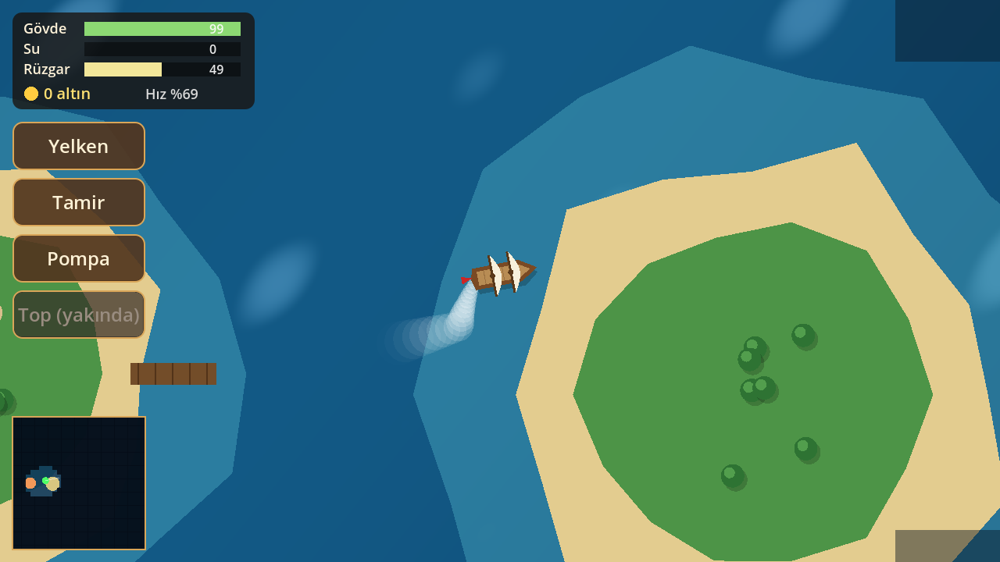
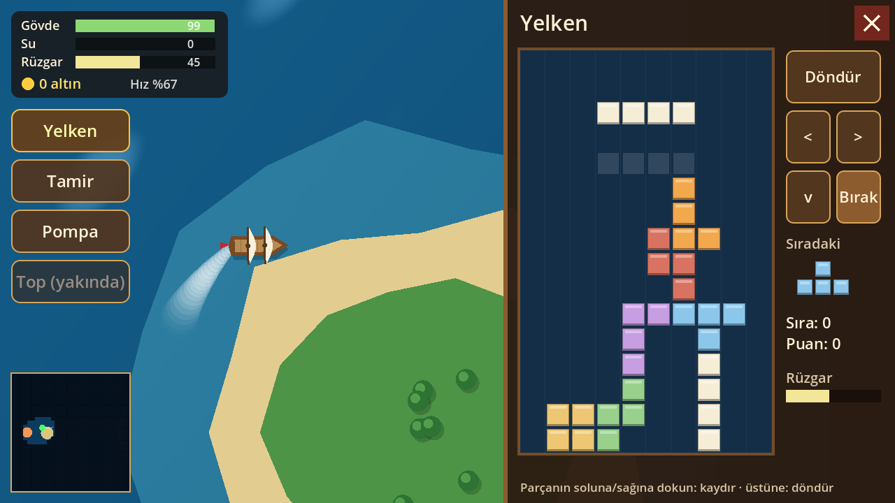
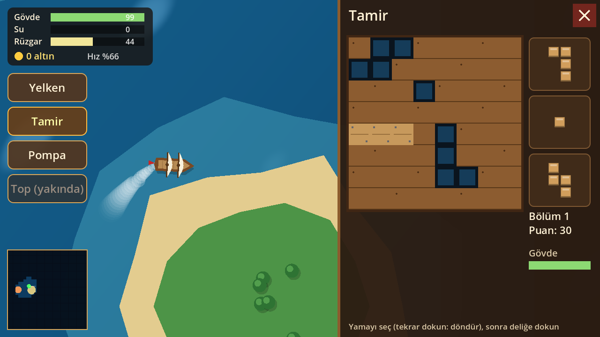
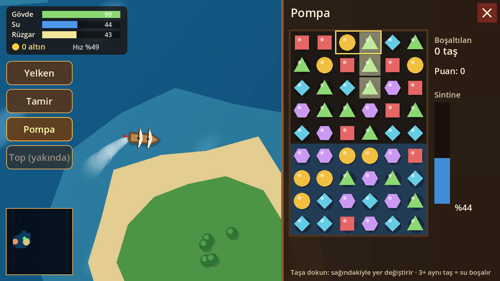

# Sea of Puzzle

Puzzle Pirates ile Seafight karışımı, açık dünya, online mobil deniz oyunu. Godot 4.3 + GDScript ile yapılıyor; online kısım ileride Nakama sunucusuyla gelecek.

**Tasarım belgesi:** https://claude.ai/artifact/KiGH3z44ZyqLpqGHgjucn1

## Telefona kurmak
Her `main` güncellemesinde GitHub Actions APK'yı derler. **Releases → "Sea of Puzzle (son sürüm)"** sayfasındaki `SeaOfPuzzle.apk` dosyasına dokunup kur.

## Nasıl oynanır (1. aşama prototipi)
- **Denize dokun:** gemi oraya yelken açar. Sis kalktıkça yeni adalar görünür; parlayan sandıklar altın verir; kayalıklar gövdeye zarar verir; limanlarda gemi onarılır.
- **Yelken (tetris):** sıra tamamla → rüzgar → gemi hızlanır.
- **Tamir:** tepsiden yama seç (tekrar dokun: döndür), uyan deliğe dokun → gövde onarılır.
- **Pompa:** taşa dokun, sağındakiyle yer değiştirsin; 3+ aynı taş → sintinedeki su boşalır.
- Boş istasyonları yapay zekâ tayfa yavaşça çalıştırır; sen oynarsan çok daha etkili olur.

## Ekran görüntüleri
| Deniz | Yelken | Tamir | Pompa |
|---|---|---|---|
|  |  |  |  |

## Yol haritası
1. **Prototip** — tek oyunculu deniz + Yelken/Tamir/Pompa ✅ (ilk sürüm)
2. Savaş ve canavarlar — savaş tahtası, Top puzzle'ı, harpun, rampa düellosu
3. Online deniz — Nakama, ekip, aynı gemide birden çok oyuncu
4. Ekonomi — pazarlar, dükkânlar, üretim puzzle'ları
5. Bayraklar, ada kuşatması, Google Play
